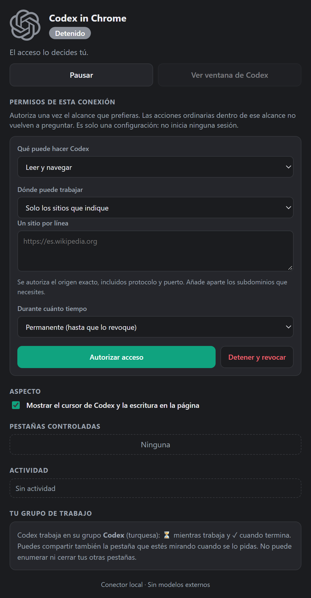

<p align="center"></p>

# Codex in Chrome

A Chrome extension plus a small local MCP bridge so **Codex CLI** can open, read, click, type, screenshot and debug pages in **your real Chrome** (your sessions, your tabs), while you decide what it may touch.

```
Codex --stdio--> server/mcp.js --ws 127.0.0.1:17333--> server/hub.js --ws--> extension/background.js
```

Everything stays on your machine: the hub only listens on `127.0.0.1`, no external model or service is involved.

## Install

Requirements: Chrome, Node.js 18+, Codex CLI.

```bash
git clone https://github.com/VortexJer/codex-in-chrome.git
cd codex-in-chrome
node install.mjs
```

`install.mjs` installs the server dependency (`ws`), copies the **Codex skill** to `~/.codex/skills/codex-in-chrome/` and registers the MCP server (`codex mcp add codex-chrome -- node <path>/server/mcp.js`). If `codex mcp add` is not available it prints the `config.toml` snippet:

```toml
[mcp_servers.codex-chrome]
command = "node"
args = ["/absolute/path/to/codex-in-chrome/server/mcp.js"]
```

Chrome does not allow installing an unpacked extension from a script, so do this once by hand:

1. Open `chrome://extensions`, enable **Developer mode**.
2. **Load unpacked** and choose the `extension/` folder.
3. Open the extension's side panel and press **Authorize access** (see below).
4. Restart Codex so it loads the tools.

Options: `node install.mjs --no-register` (skip MCP registration) and `--no-skill` (skip the skill).

### Español (resumen)

```bash
git clone https://github.com/VortexJer/codex-in-chrome.git
cd codex-in-chrome
node install.mjs
```
Luego en `chrome://extensions`: modo desarrollador → *Cargar descomprimida* → carpeta `extension/` → abre el panel lateral y pulsa *Autorizar acceso* → reinicia Codex.

## Permission panel



You grant access in the extension panel, never from the MCP:

- **What**: read and navigate only, or also interact.
- **Where**: only the origins you list, or all sites.
- **How long**: minutes, until Chrome closes, or until you revoke it.
- **Stop and revoke** at any time; clicking the extension icon pauses it (badge `II`).

(The screenshot shows the panel in its initial, not-yet-authorized state; the UI language is Spanish.)

## Tools

| Tool | What it does |
|------|--------------|
| `tabs` | list / open / close / switch / adopt / release controlled tabs |
| `go` | navigate (or back / forward / reload) and return a compact snapshot |
| `snap` | snapshot of the visible viewport with element refs |
| `do` | run several steps in one call (click, type, ...); stops at first failure and returns a diff |
| `read` | readable main text of the page (no nav/footer), optionally links |
| `shot` | small JPEG screenshot, only when visuals matter |
| `js` | evaluate JavaScript in the page (output capped) |
| `log` | console or network log of the tab |

Token-saving by design: viewport-only snapshots, diffs after actions, batched steps and tiny screenshots on demand.

## Safety model

- Only tabs in the orange **Codex** tab group are controlled; other tabs are never touched.
- The hub accepts the extension only from its pinned ID (`chrome-extension://<id>`) and rejects any browser `Origin` on the MCP endpoint, so web pages cannot talk to it.
- Page text is treated as untrusted data, never as authorization.
- Closing Chrome's "debugging" banner releases the tab.
- Per-site scope limits where tools run; it is **not** a firewall for the network requests a page makes.

The extension requests `<all_urls>`, `debugger`, `tabs` and `scripting` because that is what driving a browser takes. Read `extension/` before loading it. Its ID is pinned by the public `key` in `extension/manifest.json`, which matches `server/config.json`.

## Tests

```bash
cd server && npm test
```
Runs the access-policy and hub tests (no real browser needed).

## License

MIT
