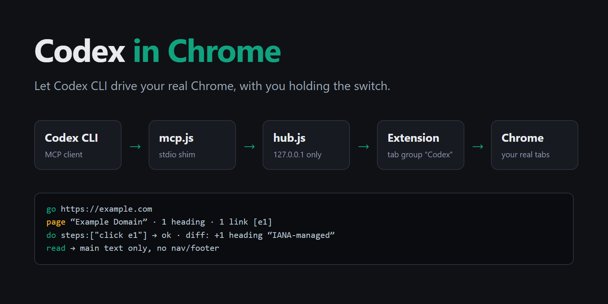

<p align="center"></p>

# Codex in Chrome

Let Codex use your real Chrome through a local MCP bridge. The extension works in a dedicated **Codex** tab group and exposes eight compact browser tools.

```
Codex -> MCP (stdio) -> local WebSocket hub -> Chrome extension
```

Use your existing Chrome login, navigate pages, fill forms, read content, and debug sites without an external browser-control model. The connector itself runs no language model and needs no API key. Codex still uses its own configured model.

## Install on Windows

Requires **Node.js 20+**, npm, Chrome with developer extensions enabled, and a Codex client that supports local MCP servers.

1. Download or clone this repository into a permanent folder.
2. Run `install.cmd`, or run `./install.ps1` from PowerShell.
3. Open `chrome://extensions`, enable **Developer mode**, choose **Load unpacked**, and select this repository's `extension` folder.
4. Open the extension panel and click **Save authorization**.
5. Restart Codex to load the MCP connector and its approval settings.

The installer downloads the locked `ws` dependency using `npm ci`, generates the local hub configuration, and updates only `[mcp_servers.codex-chrome]` and its tool overrides in the user Codex configuration. It backs up an existing configuration before changing it. No administrator access is needed.

It also installs the bundled Codex skill alongside that configuration. Use `--no-skill` to skip it. Existing modified skill text is backed up before replacement. The original `node install.mjs` entry point remains supported, including its `--no-register` and `--no-skill` options.

You can choose another configuration file explicitly:

```powershell
./install.ps1 --config "C:/path/to/config.toml"
```

`CODEX_HOME` is respected. `--skip-dependencies` is available for offline reinstalls when dependencies already exist.

Chrome requires the unpacked extension step; the installer does not change your Chrome profile or install an extension silently. Keep the repository in place while installed.

## Authorization

The panel starts with this selection:

| Setting | Default |
|---|---|
| What Codex can do | Read, navigate and interact |
| Where it can work | All websites |
| How long | Permanent (until I revoke it) |

Click **Save authorization** to grant it. The saved status is:

> Saved: read and interact · all websites · permanent

**Pause** temporarily stops operations. **Stop and revoke** disables the saved grant and detaches controlled debuggers. Access stays disabled until you explicitly save a new authorization. Existing narrower permissions are retained during updates. You can instead select read-only mode, exact website origins, a timed grant, or the current Chrome session.

The connector controls its own Codex tab group. `tabs adopt` shares only the tab you are currently viewing, when requested. Other tabs cannot be enumerated or closed through the tools. All-websites permission covers ordinary HTTP/HTTPS pages; Chrome internal pages and local files are outside that policy.

## Why chat might still ask

The extension's saved grant and Codex's MCP tool approvals are separate. The installer adds:

```toml
[mcp_servers.codex-chrome]
# command and args point to this checkout
default_tools_approval_mode = "approve"
```

It also removes old per-tool overrides for this connector, so the setting applies to all eight tools. MCP descriptions tell Codex to proceed with routine actions within your requested task and saved scope without duplicate browser-access consent. Restart Codex after installing. Host or organization policies may still require approval; a saved extension grant cannot override them. See the [official configuration reference](https://developers.openai.com/codex/config-reference/).

## Browser tools

| Tool | Purpose |
|---|---|
| `tabs` | List, create, select, adopt, release, show, or close controlled tabs |
| `go` | Navigate to a URL, back, forward, or reload |
| `snap` | Read a compact accessibility snapshot with element references |
| `do` | Batch clicks, typing, keys, selections, scrolling, waits, and uploads |
| `read` | Extract readable page text |
| `shot` | Capture a small JPEG screenshot |
| `js` | Evaluate JavaScript in the controlled page |
| `log` | Inspect page console or network activity |

Start with `go`, then use the returned references with `do`. Refresh the snapshot after navigation. Small snapshots and action diffs keep routine responses concise; screenshots are on demand.

The hub listens only on `127.0.0.1:17333` and checks the extension's pinned ID. MCP clients connect locally without a web origin. Other software running on the same computer is part of the local trust boundary. The extension checks the saved policy before operations and periodically detaches debuggers when access is no longer allowed.

## Update

Replace the checkout's files or pull changes, rerun the installer, reload the extension at `chrome://extensions`, and restart Codex. The public manifest key keeps the unpacked extension ID stable. Do not remove and reinstall the extension if you want to retain its saved local settings.

## Uninstall

1. Click **Stop and revoke** in the extension panel.
2. Run `uninstall.cmd` or `./uninstall.ps1` from the installed checkout.
3. Restart Codex and remove **Codex in Chrome** at `chrome://extensions`.
4. Delete the checkout if you no longer need it.

Uninstall removes this checkout's MCP configuration and its unmodified installed skill, preserves other servers, and leaves your source files and backups intact. It refuses to unregister a connector that points to another checkout. A locally edited skill is retained.

## Development and tests

```powershell
npm ci --prefix server
node server/keygen.mjs
node scripts/verify-core.mjs
node scripts/test-installer.mjs
python scripts/test-protocol.py
pip install -r requirements-dev.txt
python -m playwright install chromium
python server/tests/test_permission_ui.py
python server/tests/test_isolated_e2e.py
```

Browser tests use a disposable Chromium profile and isolated ports. They do not use your personal Chrome session. `CHROME_EXECUTABLE` optionally selects an existing Chromium executable. The end-to-end check covers navigation, typing, screenshots, idle detach/reattach, read-only rejection, and revocation.

See [validation notes](docs/VALIDATION.md) for what was actually run during this release and any remaining limits. CI is provided; inclusion of a workflow is not a claim that a hosted run has passed.

## History and credits

This release preserves the repository's existing history. New commits identify VortexJer as author and Codex as coauthor; earlier contributors retain their original credit.

MIT licensed. This is an independent community project.
